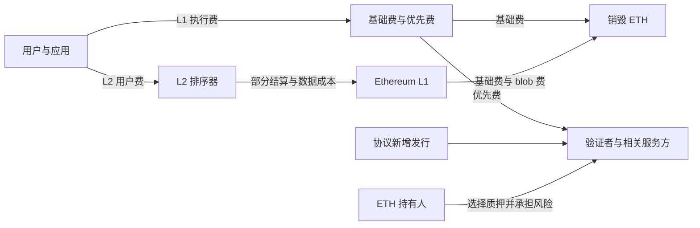

# Ethereum（ETH）研究报告

> **研究及资料截止：2026-09-07，Asia/Shanghai。** 已执行系统日期核验。  
> **估值基准价：2,487.37 美元/ETH**，CoinGecko 更新时间为当日 15:57:40；供应量约 1.220268 亿 ETH，价乘供应量复算市值约 **3,035.26 亿美元**。行情为盘中快照。  
> 历史年度采用自然年；最新完整季度为 2026Q2。链上日数据最晚到 9 月 6 日，部分数据商只到 9 月 5 日，分别注明。  
> **研究主线：Ethereum 已形成重要的金融结算网络，但 ETH 的价格还需要依靠长期货币与抵押品需求来解释；仅靠当前网络收费，难以提供传统价值投资的估值锚。**  
> 本报告用于学习与研究。研究对象是原生 ETH；基金、流动质押代币与持币上市公司具有额外的权利、费用和风险。

## AI研究偏见自觉

**信息丰富度评级：A；可估值性明显弱于资料丰富度。** 协议代码、交易记录、基金申报和研究文章都很多，但没有一份属于全体 ETH 持有人的合并财务报表。不能因资料多，就把货币溢价的持续性当成已被证明。

本次特别检验两个相反偏见：支持者容易把“更多交易、更多资产上链”直接换算成币价上涨；传统股票分析者则容易把“没有企业现金流”直接换算成没有任何经济价值。ETH 的结算、抵押和货币用途需要单独研究。

- [x] 将 Ethereum 网络、ETH 资产、Ethereum Foundation（EF）、L2 和应用的经济权益分开。
- [x] 将已上线升级、未来排期、尚在讨论的货币政策分开。
- [x] 检查美元收费下降是否只是币价变化：同时观察原币收费。
- [x] 保留不同数据商的统计差异，不用平均数制造确定性。
- [x] 不把历史高价、质押 APR、TVL 或 RWA 总额直接当作 ETH 内在价值。

**AI研究局限性声明：** 链上数据能较好回答“发生了什么”，很难单独回答“谁是最终用户、是否受激励驱动、愿意长期持有多少 ETH”。部分稳定币、L2 成本及 RWA 数据尚未完成独立逐项对账。后文的终值市值、收益要求及价格带是显式研究假设，不是可验证的公允价值，也不代表四位投资大师真实持有或评价 ETH。

---

## 第一步：核心数据总览

### 买到的是哪种权利

ETH 是支付 Ethereum 协议费用和参与质押所需的原生资产，也可作为应用中的抵押品和交易资产。持有 ETH 不赋予对 EF 财库、Circle 储备收益、Coinbase 收入或其他应用利润的索取权；协议升级也不是按持币比例举行的公司股东表决。[ETH 用途](https://ethereum.org/what-is-ether/)、[Ethereum 治理](https://ethereum.org/governance/)

| 股票研究字段 | 在 ETH 上的正确处理 |
|---|---|
| 总股本 | 改为 ETH 供应量；质押中的 ETH 仍属于供应量，不从市值分母扣除 |
| 收入 | 展示网络交易费，但不能称为持币人的公司营业收入 |
| 净利润、EPS、毛利率、ROE、自由现金流 | 不适用；不能用手续费减发行“造出”一套上市公司利润表 |
| 现金、债务、净现金、企业价值 EV | 没有全体 ETH 持有人共同拥有的合并资产负债表；EF 财库不是 ETH 的净现金 |
| 股息 | 原生现货持有不自动领取现金分红；质押收入另行承担服务、流动性和价格风险 |
| PE、PB、PEG | 不适用；市值/网络费用仅是强度指标，不能标为 PE |
| 研发投入、管理层持股 | 研发由多个团队及资助主体承担；没有可验证的统一公司式口径 |

### 市场快照与交叉核对

| 项目 | 本报告采用值 | 核验及限制 |
|---|---:|---|
| ETH 基准价格，美元 | 2,487.37 | CoinMarketCap 约 2,487.1421；Coinbase 现货 2,488.275；相对主源偏差均小于 0.04% |
| ETH 供应量，枚 | 122,026,782.2521 | CoinGecko 与 CMC 相同；ultrasound 独立供应核算约 122,020,710.0906，偏差约 0.005% |
| 市值，亿美元，价乘供应量 | 3,035.26 | CoinGecko 报告 3,035.40；CMC 报告 3,034.98；小差异来自快照和报价更新 |
| 总质押量，万 ETH | 4,295.36 | ultrasound；Beaconcha.in 当日索引约 4,295.12 万，快照并非同一区块 |
| 质押量/供应量 | 35.20% | 用 ultrasound 两项数据计算；不是独立运营者占比 |
| 参考验证者毛 APR | 约 2.6% | Beaconcha.in 与 ultrasound 的近期参考值；不是散户净收益或未来承诺 |
| 近30日年化净供应增速 | 约 +0.86% | ultrasound 动态估计，单源辅助；不保证持续，不等于币价回报 |

市场来源：[CoinGecko](https://www.coingecko.com/en/coins/ethereum)、[CoinMarketCap](https://coinmarketcap.com/currencies/ethereum/)、[Coinbase 现货 API](https://api.coinbase.com/v2/prices/ETH-USD/spot)。网络来源：[ultrasound.money](https://ultrasound.money/)、[Beaconcha.in](https://beaconcha.in/)。两家行情商相同的供应值不被当作两次独立链上重算；因此额外用 ultrasound 的执行层余额、共识层余额及已存入余额去重验证。毛 APR 的精确 API 值与 Beaconcha.in 的近期参考值相差约 1.10%，窗口及舍入不同，故这里只概括为约 2.6%，不宣称精确收益率已通过同步双源核验。

### 五年网络收费：不能用扩容叙事替代结果

下表是用户支付给 Ethereum L1 的执行基础费、优先费及适用后的 blob 费。美元值按每日原币费用乘当日 Coin Metrics 收盘价汇总；它既不是应用生态全部收入，也不是持币人净利润。美元总额另与 DefiLlama 独立日序列核对，五个完整年度的直接差异均小于 0.5%。[Coin Metrics 费用定义](https://gitbook-docs.coinmetrics.io/network-data/network-data-overview/fees-and-revenue/fees)、[Coin Metrics API](https://community-api.coinmetrics.io/v4/timeseries/asset-metrics?assets=eth&metrics=FeeTotNtv,PriceUSD&start_time=2021-01-01&end_time=2026-09-06&page_size=10000)、[DefiLlama 历史费用](https://api.llama.fi/summary/fees/ethereum?dataType=dailyFees)

| 年度 | 网络总手续费，亿美元 | 原币手续费，万 ETH | 美元手续费同比 | 与 DefiLlama 的直接差异 |
|---|---:|---:|---:|---:|
| 2021 年 | 99.20 | 344.67 | — | 0.10% |
| 2022 年 | 43.00 | 176.60 | -56.65% | 0.09% |
| 2023 年 | 24.07 | 130.91 | -44.03% | 0.01% |
| 2024 年 | 24.73 | 79.39 | +2.76% | 0.10% |
| **2025 年** | **5.21** | **17.18** | **-78.94%** | 0.47% |


**核心发现：原币手续费也持续下降，所以美元收费下降不能全部归因于 ETH 价格下跌。** 扩容、L2 迁移、交易需求与竞争共同作用；本研究没有把下降幅度全部归因于某一次升级。低费用对用户有利，但对靠稀缺区块空间收费的价值捕获形成压力。

最近四个完整季度如下，季度美元数不能与年度数不加区分地比较：

| 季度 | 网络手续费，百万美元 | 原币手续费，ETH | 核验结论 |
|---|---:|---:|---|
| 2025Q3 | 125.39 | 32,825.17 | CM 与 DefiLlama 美元差异 0.51% |
| 2025Q4 | 76.67 | 21,505.80 | CM 与 DefiLlama 美元差异 0.76%；另一原币序列存在组件差异 |
| 2026Q1 | 39.95 | 17,425.08 | CM 与 DefiLlama 美元差异 0.56%；另一原币序列存在组件差异 |
| 2026Q2 | 52.47 | 24,834.74 | CM 与 DefiLlama 美元差异 1.31%；用 growthepie 执行费加 blob 费独立核对，原币差异不足 0.001% |

2026 年 1 月 1 日至 9 月 6 日，CM 累计网络手续费约 **1.138 亿美元**。这是未完成年度，且近期美元序列仍存在来源差异；只作趋势辅助，不把它包装成已经完成双源核验的全年财务数据。2026Q2 的独立原币重建说明其收费回升有依据，但不意味着已经回到过去的高收费状态。[growthepie 执行费序列](https://api.growthepie.com/v1/metrics/chains/ethereum/fees.json)、[blob 数据](https://api.growthepie.com/v1/da_overview.json)

> 段永平式追问：如果用户越来越喜欢这个网络，却愿意支付的总费用更少，持币人的回报究竟从哪里来？

---

## 第二步：生意本质分析

**一句话：Ethereum 向需要公开验证和共享结算状态的用户出售稀缺的执行与数据空间，ETH 则同时承担费用支付、安全抵押和生态货币的角色。** 这几个角色可以相互强化，但不能相互代替。

### 钱从谁手里来，最终到谁手里

| 经济活动 | 谁支付、为什么支付 | 最终归属 | 对普通 ETH 持有人的意义 |
|---|---|---|---|
| L1 执行基础费 | 用户为执行交易支付 | 协议销毁 ETH | 减少供应；不会向钱包分发美元 |
| 优先费及部分 MEV | 用户付优先费；排序机会还产生 MEV | 验证者、构建者及相关参与者 | 需要参与相应服务才能获取；MEV 不应与同一笔手续费重复加总 |
| Blob 数据费 | L2 等为发布数据支付 | 协议销毁 ETH | 有价值捕获，但取决于实际支付额和数据供需 |
| 协议质押发行 | 协议新增 ETH 奖励验证者 | 质押参与者，扣除相关服务费用 | 增加持币数量，同时增加全网供应，属于安全预算的一部分 |
| L2 用户交易费 | 用户为更便宜、更快的交易支付 | L2 排序器先收取，再支付 L1 成本等 | 只有部分费用回流 L1，L2 收费不能整体记入 ETH 收入 |
| 稳定币、借贷、交易应用 | 用户为美元、信贷、交易等需求付费 | 发行人、应用或特定流动性提供者 | ETH 只能通过实际收费、抵押与货币需求间接受益 |

依据：[EIP-1559](https://eips.ethereum.org/EIPS/eip-1559)、[EIP-4844](https://eips.ethereum.org/EIPS/eip-4844)、[MEV 机制](https://ethereum.org/developers/docs/mev/)、[质押机制](https://ethereum.org/staking/)。



复购来自重复交易和资产结算，而非订阅合同。网络没有能够承诺提价的统一销售团队；价格由拥堵及协议资源定价机制形成。软件扩容能降低单位成本，也能削弱稀缺性租金。不能把“运行节点较便宜”直接换算成全体持币人的高毛利率。[Gas 技术说明](https://ethereum.org/developers/docs/gas/)

### 用 Base 检验 L2 的价值回流

growthepie 记录的 2026 年 8 月 8 日至 9 月 6 日，Base 用户链费约 **331.78 万美元**，支付给 L1 的费用约 **0.86 万美元**，后者只相当于前者的 **0.2593%**。其中 blob 成本包含在 L1 支出内，不能再加一次。这是单一数据集的一个月案例，不能外推为所有 L2 的永久分配比例。[growthepie 原始指标](https://api.growthepie.com/v1/fundamentals.json)、[指标定义](https://www.growthepie.com/fundamentals/fees-paid-by-users)

这个例子足以否定“L2 每收一美元，ETH 持有人也赚一美元”。L2 留存的费用还要承担服务器、开发和获客等成本，所以也不能把其链上差额当作会计净利润。另一方面，L2 使用 Ethereum 结算及 ETH 资产，有可能扩大长期抵押需求；这一较强的多头论点仍需另行验证。

### 真正决定 ETH 回报的三个变量

第一，需求增长能否快于执行与 blob 供给扩张，使真实收费和销毁恢复。第二，应用是否要求用户长期持有 ETH 作为抵押或结算储备，而不仅是交易前临时兑换少量 gas。第三，ETH 能否在其他链、稳定币及代币化国债竞争下保住货币溢价。

当前供应变化也值得单独看。ultrasound 的近30日速度年化发行约 **106.92 万 ETH**，销毁约 **1.3821 万 ETH**，销毁仅覆盖同期发行的约 **1.29%**，因此短窗口净供应仍在增长。CM 近30个完整日的年化发行与该发行估计相差不足 0.1%；精确销毁尚缺独立第二来源。销毁统计经源码确认包含执行基础费和 blob 费，年化采用数据源算法，不把短期状态外推为永久通胀。[发行与销毁 API](https://ultrasound.money/api/v2/fees/burn-rates)、[销毁实现](https://github.com/ultrasoundmoney/eth-analysis-ts/blob/main/src/fee_burn.ts)

ultrasound 的验证者收益模型显示，毛 APR 约 **2.63%**，其中发行贡献约 **96.43%**。这是该模型的当日拆解，包含收益估计，尚未独立复算所有验证者收入；它支持“主要来自发行”，不支持把全部 APR 视为新增外部利润。[验证者奖励 API](https://ultrasound.money/api/fees/validator-rewards)

质押只能改变持币数量路径，不能保护美元本金。作为纯算术示例，假设一年净增币 **2.5%**，同期币价下跌 **30%**，美元回报仍为 **-28.25%**。未来情景中的净质押率只是敏感性假设；发行奖励、优先费、服务成本、退出队列与罚没都可能改变实际结果。

> 段永平式追问：我是在购买持续增加的外部支付需求，还是在把新增发行和货币溢价误当成稳定经营利润？

---

## 第三步：护城河评估

| 护城河来源 | 评价 | 具体机制 | 可推翻判断的证据 |
|---|---|---|---|
| 品牌与可信中立性 | 较强，定价权有限 | 长期运行、公开验证、抵押和结算惯例形成信任 | 大型参与者持续迁走结算资产；规则修改损伤中立性 |
| 转换成本 | 中到强 | 迁移涉及合约、安全审计、流动性、托管及交易对手 | 新发行资产优先部署到其他网络，跨链迁移成本显著下降 |
| 网络效应 | 较强 | 资产、开发工具、应用与抵押品能相互组合 | 有用应用增加，但 ETH 抵押需求、收费及资本份额持续下降 |
| 规模与成本优势 | 混合 | 更多参与者分担工具和安全研发；L2 降低用户成本 | 扩容只增加复杂性与中介收入，无法增加 ETH 的经济回流 |
| 技术壁垒 | 中等，非专利垄断 | 多客户端协调、规范和安全经验难以短期复制 | 替代执行架构在可靠性、体验及费用上形成持续优势 |

过去五年，Ethereum 的生态深度、PoS 运行经验和可扩展性增强；但单笔执行与数据空间的稀缺性下降，竞争链也在发展。**生态护城河有所积累，代币收费的定价权却没有同步变宽。** 开源代码可以复制，已经形成的流动性、可信结算记录和协作体系较难复制；这两点可以同时成立。

开发者数据支持历史积累，却不能提供实时保证。Electric Capital 的官方年度报告目录目前覆盖 2018—2024，2024 年研究中 Ethereum 的总开发活动领先、Solana 的新增开发者突出；这不是 2026 年 9 月已经验证的实时排名。[官方报告目录](https://www.developerreport.com/developer-report)、[2024 年研究](https://www.developerreport.com/reports/devs/2024)

未来五年的护城河判断取决于可观察结果：更多高价值资产是否真正选择 Ethereum；ETH 是否仍是主要的非主权抵押品；客户端与验证服务是否足够分散；费用下降后新增需求是否补得回来。稳定币余额的增长本身不能完成这组证明。

> 巴菲特式追问：十年后仍难以复制的是安全与资本网络，还是今天短暂的交易习惯？它能给 ETH 持有人保留多少经济利益？

---

## 第四步：逆向思考与风险清单

**最强反方并不需要 Ethereum 失败：网络可以被广泛使用，用户以稳定币计价，L2 与应用掌握客户，ETH 只承担廉价 gas 和安全抵押；这种结构未必支持今天的货币溢价。** 因而“链还在运行”不是投资论文得到验证。

下表是研究者的定性风险排序，没有可靠基率支持精确概率。

| 失败路径 | 发生倾向判断 | 对投资的影响 | 应观察的信号 |
|---|---|---|---|
| 使用增长而收费与 ETH 持有需求不增长 | 高度关注，已有费用侧证据 | 长期回报低于预期 | 完整季度费用、销毁、L2 付 L1 成本与 ETH 抵押需求 |
| 货币溢价压缩 | 中高，无法量化 | 可以在主网正常时造成大幅亏损 | ETH 抵押用途减弱，新增资产主要以其他抵押品或网络结算 |
| Solana、Tron、其他链或许可基础设施抢走用途 | 中 | 降低网络效应和预期增长 | 同口径资产存量、真实交易流量及发行人部署选择 |
| 协议、客户端或密码学重大故障 | 低频，但后果极高 | 信任受损、永久资本损失 | 主网最终确认、多客户端一致性、修复速度及安全研究 |
| 委托质押、托管、构建者集中 | 中 | 审查、关联失效和治理压力 | 按有效质押额及控制实体统计的集中度，不能只数品牌和地址 |
| 合约、桥、再质押风险传染 | 中 | 应用损失可能削弱生态信任 | 抵押品脱锚、强制清算、隐含救助要求；不能把应用安全等同于 L1 安全 |
| 质押规则、奖励或退出条件变化 | 中 | 增币回报和可用流动性低于设想 | 提案状态、实际实施、服务收费及退出队列 |
| 本地交易、托管和法律保护受限 | 因司法区而异 | 投资路径可能不可行 | 适用法规及具体产品文件，而非海外市场能否交易 |
| 杠杆与资金期限错配 | 投资者可控 | 在论文尚未证伪前被迫清仓 | 借款、保证金、短期资金需求与可承受损失 |

技术风险需要分层。共识相关失效达到相应有效质押门槛可以阻碍最终确认，但本研究未取得同步、独立核验的控制实体份额，不能断言某一机构当下已经超过门槛。再质押及桥的损失也不自动意味着 Ethereum 主网被攻破。[PoS 攻防](https://ethereum.org/developers/docs/consensus-mechanisms/pos/attack-and-defense/)、[Vitalik 对共识风险外溢的讨论](https://vitalik.eth.limo/general/2023/05/21/dont_overload.html)

历史类比只用来检查机制：开源基础设施可以创造极大社会价值，但价值分配可能偏向服务商、应用与用户；支付网络可以有高周转量，却不要求每位用户长期持有大量原生资产。另一方面，货币资产也能因抵押便利和可信度保有长期溢价。这些类比支持的是不同可能性，不是 ETH 的历史收益回测。

**最可能的分析错误：** 用收费去解释全部货币价值，从而低估 ETH；或者反过来，用“货币资产不需要现金流”来免除任何价格纪律。本报告用费用诊断与显式货币终值情景交叉检验，仍不声称找到可兑现的价格底部。

> 芒格式追问：如果五年后亏损，最可能是网络坏了，还是网络没有坏、只是我高估了 ETH 能留下来的价值？

---

## 第五步：管理层与治理评估

Ethereum 没有一个对持币人负责的公司 CEO。EF 是重要资助和协调机构，客户端团队、研究者、节点运营者及经济参与者共同影响协议选择。EF 的使命强调用户自主、抗审查、开源与安全，这些目标有利于网络长期可信度，却不构成提高币价或分配利润的法律义务。[EF Mandate](https://ethereum.org/foundation/mandate)

截至研究日，EF 的共同执行管理角色包括 Hsiao-Wei Wang 与 2026 年 2 月被任命为临时共同执行董事的 Bastian Aue；Vitalik 仍有显著研究与声誉影响。不能把旧的管理层名单沿用为当前事实，也不能把公开地址余额当成完整个人受益持币比例。[2026 年管理层更新](https://blog.ethereum.org/2026/02/13/leadership-update)、[2026 年董事会更新](https://blog.ethereum.org/2026/07/29/ef-board-update)

| 时间 | 关键决策及状态 | 对长期投资的评价 |
|---|---|---|
| 2016 年 | DAO 救济硬分叉 | 有危机协调能力，也说明极端情况下社会共识会改变状态规则 |
| 2022 年 | The Merge 已完成 | 大型运行中系统迁移的正面记录；安全预算与风险结构同时改变 |
| 2024 年 | Dencun 已完成 | Blob 降低 L2 数据成本，产品目标实现不等于持币人收入增加 |
| 2025 年 | Pectra、Fusaka 已完成 | 钱包、验证者及数据能力改善，体现持续交付能力 |
| 2025—2026 年 | EF 公布财库政策并开始自主质押计划 | 资助纪律和运作透明度改善；财库与质押所得仍归 EF，不计入 ETH 的现金与股息 |
| 研究日以后 | Glamsterdam 尚未主网上线，Q4 为目标窗口；Hegotá 仍在规划，路线图列为 2027 | 只能当待验证的技术演进，不能提前计入已实现经济收益 |

来源：[DAO 分叉公告](https://blog.ethereum.org/2016/07/20/hard-fork-completed)、[Merge](https://ethereum.org/roadmap/merge/)、[升级历史](https://ethereum.org/ethereum-forks/)、[EF 财库政策](https://blog.ethereum.org/2025/06/04/ef-treasury-policy)、[EF 质押计划](https://blog.ethereum.org/2026/02/24/staking)、[Glamsterdam](https://ethereum.org/roadmap/glamsterdam/)、[最新路线图](https://ethereum.org/roadmap/)。具体测试网日期存在官网与最新会议/PR更新不同步的情况，因此本报告不把测试网排期当作确定的主网催化日期。[核心开发排期记录](https://github.com/ethereum/pm/pull/2205)

货币政策也不是静态合同。EIP-8363 提议随质押占比提高销毁部分发行奖励；截至研究日仍是 **Draft**，未上线。它不改变本报告对当前规则的描述，但提醒投资者：质押收益率会受到经济设计与治理取舍影响，不能被永久资本化为固定股息。[EIP-8363](https://eips.ethereum.org/EIPS/eip-8363)

本研究对技术协调和持续交付给出正面评价，对“持币人利益一致性”保持中性：多方制衡减少个人任意性，却也没有公司式剩余索取权。完整管理层持币、薪酬及关联经济利益未充分披露，不虚构资本配置 ROIC 或管理层持股率。

> 段永平式追问：如果 Vitalik 退出日常研究，客户端与资助体系能否继续运转？即使能运转，它是否仍会优先创造 ETH 持有人的经济利益？

---

## 第六步：行业与文明趋势

### 资本深度仍是优势，交易与发行已是多链竞争

下表来自同一轮 DefiLlama 抓取。TVL 与稳定币是 9 月 7 日可得存量快照；链费采用 8 月 7 日至 9 月 5 日。金额均为美元；这些运营指标尚未全部完成独立资产清单复核。

| 网络 | DeFi TVL，十亿美元 | 美元挂钩稳定币，十亿美元 | 30日链费，百万美元 | 经济位置 |
|---|---:|---:|---:|---|
| Ethereum L1 | 49.624 | 147.177 | 10.741 | 高价值资产、抵押与结算中心 |
| Solana | 5.925 | 16.361 | 22.044 | 独立执行与交易生态 |
| Tron | 5.452 | 93.762 | 24.835 | 稳定币转移的重要网络 |
| Base | 5.669 | 4.902 | 3.324 | Ethereum L2，兼具生态扩张和费用留存效应 |

来源：[DefiLlama 链数据](https://api.llama.fi/v2/chains)、[稳定币链数据](https://stablecoins.llama.fi/stablecoinchains)、[费用数据](https://api.llama.fi/overview/fees?excludeTotalDataChart=true&excludeTotalDataChartBreakdown=true&dataType=dailyFees)。Ethereum 的 DeFi TVL 约为 Solana 的 **8.38 倍**，但该月链费并未领先。TVL 会随币价、抵押与统计覆盖变化，不等于流入的法币本金，更不是可分配现金。

这些存量不能相加形成“ETH 的总资产”：L1、L2、桥接资产、抵押凭证、RWA 和稳定币存在交叉关系。Ethereum L2 也不能一面被算作完全独立竞争链、一面又在总量里无条件全部归给 ETH。

RWA.xyz 的 9 月 7 日数据中，不含稳定币的 Distributed RWA 全球约 **391.94 亿美元**，Ethereum L1 约 **176.34 亿美元**，占 **44.99%**。这是实际可由投资者持有的分发型资产口径，不能与主要用于记录和对账的 Represented 口径混用，也未把 Ethereum L2 加入分子。该组为单源数据，不拿来构造精确估值倍数。[RWA.xyz 网络表](https://app.rwa.xyz/networks)、[分类说明](https://app.rwa.xyz/blog/a-new-framework-for-tokenized-assets-distributed-and-represented)

稳定币双源存在实质缺口：DefiLlama 的 Ethereum 美元挂钩口径为 **1,471.77 亿美元**，RWA.xyz 为 **1,594.64 亿美元**，差异约 **8.35%**。逐币排查显示主要差额集中于 USDT；加入非美元币种仍不能消除差异，桥接、未流通余额与资产覆盖尚未完成同区块调节。因此不求平均，也不宣称精确份额已双源验证。[RWA.xyz 稳定币表](https://app.rwa.xyz/stablecoins)、[DefiLlama 逐币数据](https://stablecoins.llama.fi/stablecoins?includePrices=true)

### 文明级用途不自动等于代币级利润

可编程结算、全天候抵押、跨境美元流通及资产代币化具有长期用途。Ethereum 的潜在市场因此不能只按今天的交易手续费理解。但也不能拿全球金融资产总额乘一个随意比例，就得出 ETH 目标市值。

中间必须证明三个环节：新增资产选择 Ethereum；结算或抵押需要持续持有 ETH；这些需求增长足以补偿费用压缩、供应变化及替代品竞争。例如，稳定币储备中的利息主要归发行主体，ETH 持有人没有相应索取权；代币化国债的利息也主要归该资产持有人。[Circle 财报中的储备收入说明](https://www.circle.com/pressroom/circle-reports-second-quarter-2026-results)

机构通道确实扩展了可达投资者。BlackRock 的 ETHB 于 2026 年 3 月开始交易，截至研究日已有质押相关现金分派记录；ETHA 仍需按其独立条款分析。Grayscale 也已有质押奖励分派记录。不能沿用“美国所有 ETH 产品都不能质押”的旧结论。基金持有 ETH 是需求渠道，不是 Ethereum 的营业收入；基金 AUM 也不等于当期净流入或全部由机构最终持有。[BlackRock ETHB 上市公告](https://www.ishares.com/us/literature/press-release/ethb-press-release.pdf)、[ETHB 首次分派申报](https://www.ishares.com/us/literature/fund-announcement/ethb-8k-06-05-26.pdf)、[Grayscale 分派申报](https://www.sec.gov/Archives/edgar/data/1725210/000119312526002696/staking_distribution_pr_.htm)

监管应按地区和产品分别理解。美国 SEC/CFTC 的 2026 年解释将 ETH 列为 digital commodity，但并不使所有包装产品、投资合同或再质押安排自动获得同等处理。若适用中国内地规则，2026 年银发〔2026〕42号已替代旧通知，相关业务及境外对境内服务的限制必须纳入投资可行性判断；不能把海外上市当作本地操作许可。[SEC/CFTC 原文](https://www.sec.gov/files/rules/interp/2026/33-11412.pdf)、[中国证监会发布的新通知](https://www.csrc.gov.cn/csrc/c100028/c7614318/content.shtml)

> 李录式追问：二十年后，可编程金融可能更重要；但稀缺价值究竟留在公共结算层、发行人、应用，还是用户手中？

---

## 第七步：估值与安全边际

### 当前价格买下了什么预期

| 估值观察项 | 结果 | 正确解释 |
|---|---:|---|
| 市值/2025年网络总手续费 | 582.90 倍 | 全部收费仍不是持币人盈利，不能标作 PE |
| 市值/近30日原币费用按现价重估的年化额 | 约 2,049.86 倍 | 8/8—9/6 原币费量按固定现价与全年天数换算；不是已经实现的年收入 |
| 传统 PE、PB、股息率、FCF yield | 不适用 | 不编造 EPS、净资产或持币人现金流 |
| 对比 CoinGecko 历史最高价 | 约 -49.71% | 高点约 4,946.05 美元，发生于 2025-08-24；历史高点不是内在价值 |

近30日原币收费按现价重估年化约 **1.4807 亿美元**。同期原币费量 CM 为 4,892.8179 ETH，growthepie 执行费加 blob 费为 4,892.8040 ETH，差异不足 0.001%。年化重估值和数据商按历史日价格汇总的美元年化额不同，不应把两者差异误认成漏收费用。计算采用固定价格只是为了隔离币价变化；未来收费不会机械重复。[CM 原币费量](https://community-api.coinmetrics.io/v4/timeseries/asset-metrics?assets=eth&metrics=FeeTotNtv,PriceUSD&start_time=2026-08-08&end_time=2026-09-06&page_size=10000)、[growthepie 执行费](https://api.growthepie.com/v1/metrics/chains/ethereum/fees.json)、[growthepie blob 费](https://api.growthepie.com/v1/da_overview.json)

同行比较也必须尊重权利结构：BTC 的货币价值不能用企业 PE 衡量；SOL、TRX 的收费、销毁及奖励分配与 ETH 不同；有真实自由现金流的企业则有股东剩余索取权。上一节的费用比较用于判断竞争强弱，不能据此推出“链费倍数低的代币一定更便宜”。

### 反向 DCF：只靠收费，需要多激进的假设

ETH 没有普通股式现金流，因此这里做的是一个**偏宽松的收费代理诊断**：假设 2025 年全部网络手续费都能成为持币人可分配现金，忽略新增发行和验证服务成本，以其规模作为研究时点的起始年化值。这个前提并不真实，目的是检查收费能否解释市值。

模型假设前十年按固定速度增长，折现率为 **15%**，之后永续增速为 **3%**。以 2025 年约 5.207 亿美元为起点，要匹配当前约 3,035.26 亿美元市值，前十年的手续费代理需要每年增长约 **70.13%**，第十年达到约 **1,057.85 亿美元**。

公式为前十年代理现金流现值之和，加上按第十年代理现金流计算的永续终值现值。折现率与永续增速是研究者假设，不是协议参数。计算结果说明：即使给予收费非常宽松的经济归属，当前估值也隐含极强的增长或显著的其他货币价值。

这不证明 ETH 没有价值。抵押便利、结算可信度与货币接受度可以形成超出当期收费的价值；但它们需要被单独论证。**本代理 DCF 不被当作 ETH 公允价值，也不与下面的货币市值情景相加。**

### 五年三情景：将货币溢价假设摆在明处

由于不能从现有现金流可靠反推出终值，本节直接设定五年后的 ETH 总市值，再按供应量计算每枚价值。三个终值是压力情景，围绕当前资本规模分别测试溢价收缩、温和扩张与显著扩张；它们不是从 TAM、PE 或精确概率模型推出的预测。

悲观情景仍假设网络存续，但 ETH 的货币溢价明显收缩；中性情景假设资本网络地位保持，需求增长超过新增供应；乐观情景要求全球可编程金融对 ETH 的抵押及货币需求明显增加。中性情景的供应增速已低于当前短窗口估计，隐含销毁恢复或发行变化，不能被理解为机械延长当前状态。

预测时点为 2031-09-07。公式：终期供应量＝当前供应量×（1＋净供应增速）五次方；终期每枚价格＝终期总市值÷终期供应量。

| 参数或结果 | 悲观 | 中性 | 乐观 |
|---|---:|---:|---:|
| 终期总市值假设，亿美元 | 1,000 | 4,500 | 9,000 |
| 年净供应增速假设 | +0.8% | +0.4% | 0.0% |
| 终期供应量，百万 ETH | 126.987 | 124.487 | 122.027 |
| **五年后情景价格，美元** | **787.48** | **3,614.84** | **7,375.43** |
| 相对现价累计币价回报 | -68.34% | +45.33% | +196.52% |
| 仅币价年化回报 | -20.55% | +7.76% | +24.28% |
| 假设年净增币2.5%后的年化回报 | -18.56% | +10.46% | +27.39% |
| 按15%币价年回报要求折回今天，美元 | 391.52 | 1,797.21 | 3,666.89 |

这里没有用 EPS 或 PE 冒充代币现金流。净增币 **2.5%** 是持续再投入奖励的敏感性假设，未计个人税负；不代表任何基金或质押服务承诺。供应量已经纳入增发和销毁，不能再把“销毁收益率”额外加进总回报。对质押者同时计算全网稀释与个人币量增加并非重复，而是在分别计算分母与分子。情景没有赋予概率，悲观情景也不是损失下限；严重失败可比表中结果更差。

从现价出发，若要求五年币价年化 **15%**、采用中性供应假设，终期总市值需达到约 **6,228.07 亿美元**，约为当前复算市值的 **2.05 倍**。若真的能够持续净增币 2.5%，所需终期市值仍约 **5,504.70 亿美元**。投资者需要对这种货币需求扩张有自己的依据，不能仅依赖质押 APR。

### 把价格变成行动条件

本报告以 **15%** 作为承担上述不确定性的主观回报要求，不称其为客观资本成本。中性终值对应的现货入场上限约为 **1,797 美元**；再对这个上限留 **20%** 假设折扣，得到约 **1,438 美元**。据此将 **1,400—1,800 美元**作为取整后的有条件研究与分批试仓区间。

该区间依赖 4,500 亿美元中性终值，不是坚实的内在价值底部。若不认可这个货币终值，价格带就没有成立依据；若论文恶化，价格低于该带也不自动构成买点。

| 假设买入价，美元 | 同一中性终值下的币价年化回报 | 研究用途 |
|---|---:|---|
| 1,400 | +20.89% | 有较多假设缓冲，但仍需验证网络与货币需求没有恶化 |
| 1,600 | +17.70% | 可讨论小额、非核心配置 |
| 1,800 | +14.96% | 接近本报告主观回报门槛 |
| 2,487.37 | +7.76% | 当前价格需要更乐观的终值或更低的回报要求 |
| 3,000 | +3.80% | 若基本面证据未增强，不宜因价格上涨而追加估值 |
| 4,000 | -2.00% | 中性终值不能支持此入场价；需要重新证明乐观情景 |


机会成本不只是错过币价上涨。选择 ETH，意味着放弃同期可获得的现金收益或具有可验证现金流的其他资产，并承担托管、技术及大幅波动。对需要稳定支出或五年内可能动用本金的资金，这些差异比名义质押率更重要。

> 巴菲特与段永平式追问：如果五年不能出售，我是否愿意在今天的价格上承担货币溢价收缩？我期待的回报有多少来自可观察的需求，有多少来自下一位买家的估值？

---

## 第八步：最终决策与行动清单

**研究结论：现价约 2,487 美元，观望；已有小额持仓可在论文仍成立时持有，但不因质押收益或低于历史高点而自动加仓。ETH 更适合作为高不确定性的货币与技术资产配置，不具备本报告要求的核心价值仓确定性。**

| 维度 | 判断 | 信心度 |
|---|---|---|
| 生意与用途 | 公开结算、抵押及可编程资产有实际用途；持币人没有公司式盈利权益 | 对机制较高，对未来需求中等 |
| 护城河 | 资本、工具与安全协作网络较强；收费定价权较弱 | 中高 |
| 治理与人 | 大型升级交付记录正面，多方治理；与持币人之间缺少公司式收益契约 | 中等 |
| 最大风险 | 网络成功但代币价值捕获不足，货币溢价下降 | 风险机制清楚，概率难量化 |
| 文明趋势 | 可编程金融有长期发展空间，利润分配仍在竞争 | 中等 |
| 估值 | 当前价格下中性回报不足以满足本研究门槛，无法验证现金流式安全边际 | 算术高，终值低 |

| 投资者或条件 | 行动建议 |
|---|---|
| 空仓、追求核心价值投资 | 继续观察；不为获得质押率而买入 |
| 空仓、能够承担高风险且认可货币论文 | 在 1,400—1,800 美元附近重新核对论文，再考虑小额分批；低价与论文改善须同时成立 |
| 已有小额、无杠杆持仓 | 若仍认可 ETH 抵押与货币地位，可持有并按季度复核；仓位上限依据可损失预算决定 |
| 持仓已影响生活资金、集中度或睡眠 | 先降低与资金期限不匹配的敞口，不用“长期看好”替代风险预算 |
| 价格进入 3,000—4,000 美元而经济证据未增强 | 复核并考虑减仓；中性情景不能提供足够新增回报，不以单一价格机械清仓 |
| 论文被破坏 | 降低或退出敞口，不以跌幅作为继续加仓的理由 |

加仓信号应来自实际结果：连续完整季度的费用和销毁改善，并能排除短期异常交易；L2 扩张对 L1 支付和 ETH 抵押需求的贡献增加；高价值发行与流动性地位稳定；协议升级通过主网运行证明安全和可用性。单纯“升级成功”“ETF 买入”“质押率提高”都不足以独立触发加仓。

减仓或退出信号包括：真实资本与发行需求持续迁离；ETH 抵押用途被更有吸引力的资产替代；系统性安全或中立性遭到破坏；实际规则变化使个人持有方式的收益与风险明显恶化。费用弱但货币需求强时，需要重估；二者同时持续恶化时，论文的支撑明显减少。

建议季度跟踪同一口径的费用、基础费与 blob 销毁、发行、净供应变化、L2 支付给 L1 的费用、非重复计算的稳定币与 RWA 资产、ETH 抵押用途、集中度及基金实际持币数量。每次核查都保留数据日期，不能用一个繁荣的运营指标替代整个投资论文。

以下为四种方法论的模拟点评，**不是本人原话，也不是他们对 ETH 的实际投资立场**：

> 段永平式：用途已经能看见，但“这门生意好”还需要进一步落实到持有者的回报。

> 巴菲特式：我愿意承认网络效应，却仍需要知道自己拥有哪一种经济权利，以及付了什么价格。

> 芒格式：最危险的错误是把所有生态繁荣，都记到同一个代币的收益账上。

> 李录式：技术趋势可能持续很久，谁能长期保有价值，仍需要逐项验证。

> 综合追问：下一次改变买卖决定，是因为价格和证据共同改变，还是因为市场情绪改变？

---

## AI分析置信度与投资确定性

**较高置信度：** ETH 的基本权利结构、费用和质押机制、当前报价与供应规模、完整年度手续费明显下降，以及已实施和未实施升级的区分。费用史经过独立数据商核对，供应量还进行了独立账务重构。

**中等置信度：** 资本和工具网络效应仍较强、本期观察的 L2 案例费用回流有限、其他链在部分用途上形成竞争。方向有数据支持，但 TVL、RWA、稳定币及近期费用的精确口径并非全部完成双源对账。

**低置信度：** 五年后市场愿意给予 ETH 多少货币溢价、实际净供应增长、持续净质押收益，以及哪一个价格一定有安全边际。情景计算精确并不会提高这些输入本身的确定性。

因此，本报告的 AI 分析置信度为中高，实际投资确定性为中低。重要的一手验证包括：发行机构选择网络及抵押品的实际原因；L2 的全部成本与 ETH 储备政策；稳定币桥接和未流通余额调节；质押、客户端及构建者的最终控制实体分布。

## 数据来源与审计记录

市场、网络、竞争及治理来源已在相关结论附近列明。原始快照、计算输入、程序及抽检底稿保存在本报告相邻的 `research` 目录；它们不改变报告中对单源数据和模型假设的标记。

### 关键数据交叉验证记录

| 项目 | 主来源 | 交叉来源或复算 | 结论 |
|---|---|---|---|
| ETH 价格，美元 | CG 2,487.37 | CMC 2,487.1421；Coinbase 2,488.275 | 直接差异均小于 1% |
| ETH 供应量，枚 | CG 122,026,782.2521 | CMC 相同；ultrasound 122,020,710.0906 | 独立供应口径差异约 0.005% |
| 市值，亿美元 | CG 3,035.40 | 价乘供应量 3,035.26；CMC 3,034.98 | 通过单位及数量级验证 |
| 2025 总手续费，亿美元 | CM 5.20714 | DefiLlama 5.23172 | 直接差异 0.472%，完整年度通过 |
| 其他完整年度费用 | CM 日序列 | DefiLlama 日序列 | 全部年度直接差异小于 0.5% |
| 近期费用与稳定币 | 正文所列数据商 | 同期、组件及逐币核对 | 有差异项保留，未强行标成一致 |
| 净利润、现金、管理层持股、传统估值倍数 | 不适用或未充分披露 | 不编造替代数据 | 不执行无经济意义的公司式验算 |
| 五年情景、反向 DCF、价格门槛 | 明确标示的模型输入 | 共享工具输出并用 Decimal 独立复算 | 验证算术，不验证未来假设 |

共享金融工具输出及独立 Decimal 复算摘录（B 为十亿美元；Shares 在这里代指 ETH 供应量）：

```text
  股价 (Price):       2487.37 USD
  总股本 (Shares):    122.03M
  计算市值:           303.53B USD
  报告市值:           303.54B USD
  偏差:               0.00%

  ✅ CoinGecko API       : 2,487.37 USD/ETH  (偏差 0.00%)
  ✅ CoinMarketCap       : 2,487.14 USD/ETH  (偏差 0.01%)
  ✅ Coinbase spot       : 2,488.28 USD/ETH  (偏差 0.04%)

DECIMAL CHECK [market cap]: 303525757370.4052805364
```

完整记录：[市场及情景验算](research/financial-rigor-valuation.txt)、[年度与近期费用核验](research/network-financial-rigor-20260907.txt)、[收费诊断](research/financial-rigor-fee-diagnostics.txt)、[竞争数据核验](research/competition-calculations.txt)。共享 `calc` 的实现存在先浮点求值再转换的问题，因此本研究另外保留字符串 Decimal 计算结果作为精度依据；没有修改公共工具。

### 抽检结果与保留事项

已按随机种子 42 运行 15% 抽检：工具识别 76 个候选项，抽中 12 项，其中 5 项实际是 L2 名称或日期片段，已保留原始记录并排除出数值通过数量。另补核工具容易漏掉的年度、季度、竞争与全部情景数据 59 项，共检查 66 项实际数值或模型输入。

其中 65 项与所列来源、明确标示的模型输入或独立算术复核相符；1 项为正文已披露的 Ethereum 稳定币来源差异，未消除。模型假设只核对录入及计算，不冒充可以从外部取数验证的未来事实；单源运营指标也只核对引用是否准确，不升级为独立双源认证。

共享抽检工具在一个来源通过、另一个来源不通过时，会保留警告但仍输出“准出”。本研究没有据此认定全部数据达标，严格复核摘要明确保留未完成双源发布标准的状态。**本报告是完成分析并标注来源缺口的研究稿，不宣称全部指标已经获得双源发布准出。** 近期费用的组件差异、精确销毁第二来源及部分资产存量覆盖仍需继续核对；它们没有被作为无保留的精确估值分母。

抽检留痕：[随机样本](research/audit-random-results.json)、[补充核验](research/audit-supplement-results.json)、[工具原始判决](research/audit-verdict.txt)、[严格复核摘要](research/audit-summary.json)。
