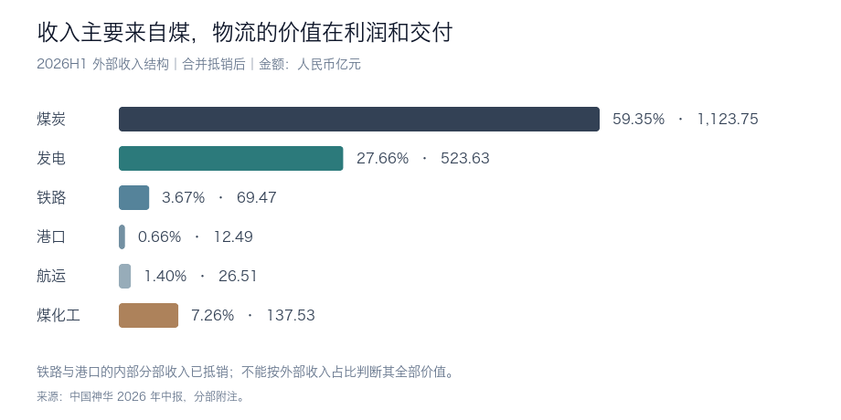
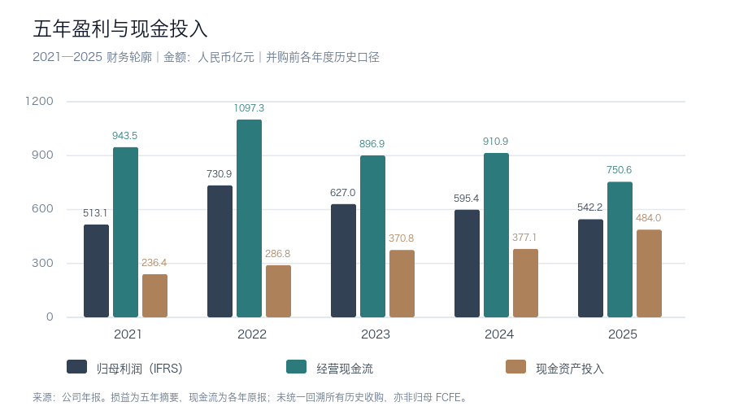

# 中国神华（HK:01088）研究报告

> **研究日期与数据截止：2026-09-07，Asia/Shanghai。** 财务截至2026H1，完整月度经营数据截至2026年7月；纳入9月3日股东会文件和9月4日管理层业绩说明会。  
> **估值价格：HK$44.72，9月7日15:12:25盘中快照，非收盘价。** 汇率为当日中间价：1港元兑人民币0.86465元。  
> **市值与估值：** H股类别市值1,510.41亿港元；全部股份按H股价格标记9,699.52亿港元，折人民币8,386.69亿元。按期末股本计算的H1 IFRS利润简单年化PE为13.50倍，PB为1.83倍。  
> **研究命题：** 神华靠低成本矿山与自有铁路、港口反复赚取能源供应的利润；收购扩大了这套系统，但投资回报最终取决于每股可分配现金和买入价格。  
> 本报告用于学习与研究，不构成投资建议。除特别注明，财务金额统一为人民币亿元；每股价格明确区分人民币与港元。

## AI研究偏见自觉

**信息丰富度评级：A。** 神华上市时间长，同时披露国际财务报告准则（IFRS）和中国企业会计准则（CAS）报表，月度经营资料充分。主要研究陷阱是资料很多，却把“一体化、央企、高股息”直接等同于低风险、高回报。

- [x] 区分实物资产的稀缺性与股东买入后的收益率。
- [x] 区分同一控制合并后的重述同比、收购增厚和有机增长。
- [x] 区分集团现金、母公司单体现金及普通股股东可归属现金。
- [x] 检验最强反面论点：投资者是否已为稳定性支付过高溢价。

**AI研究局限性声明：** 公开资料能较好还原账面财务和交易条款，无法替代矿井实地核查，也无法确认未来煤价、全部维持性资本开支、集团内部资金调度或收购后真正的股东现金回报。正文将公告事实、推算和估值假设明确区分。即使减少一半资料，本报告仍会围绕同一个问题：正常煤价下，买入价格能否由持续的每股现金创造力支撑。

---

## 第一步：核心数据总览

### 股价、股本和市值

新浪报价为HK$44.72；腾讯同次抓取返回15分钟较早的HK$44.80，差异0.18%，来自时点不同。两者前收盘价均为HK$45.74，与StockAnalysis的9月4日收盘记录一致。A股9月7日收于人民币46.09元，腾讯与新浪一致。8月证券变动月报的**已发行股本页**与腾讯股数一致；月报首页旧注册股本不用于估值。[新浪报价][S33]、[腾讯报价][S34]、[已存行情快照](data-20260907/quote-snapshots.json)、[前收盘记录][S2]、[8月股本月报，第2页][S3]、[汇率公告][S4]

| 项目 | 核定值 | 使用方式 |
|---|---:|---|
| 全部已发行股份 | 21,689,434,304股 | 全公司每股经济利益分母 |
| 其中A股 / H股 | 18,311,952,304 / 3,377,482,000股 | A/H股份在重大经济权利上同等 |
| H股盘中价 | HK$44.72 | 本报告估值固定快照 |
| H股折人民币 | 38.667元 | 采用研究日汇率 |
| H股相对A股折价 | 16.11% | 相对折价本身不证明绝对低估 |
| H股类别市值 | 1,510.41亿港元 | H股价格×H股股数 |
| 全股本按H股价格标记 | 9,699.52亿港元 | 折人民币8,386.69亿元 |
| A/H各自价格加总市值 | 人民币9,745.95亿元 | A股市值加H股市值折人民币 |

分析H股投资回报，本文使用H股买价与全公司归母每股收益。不能用H股类别市值除以全公司利润，也不能把A/H合计市值与全股本H股等值市值互换。

### 半年报：新合并范围下的可比增长

下表2025H1均为重述后数字。收入、归母利润和经营现金流由原始报表与AASTOCKS、东方财富交叉核对；毛利及详细重述事项以公司原表为主。[中报，第7—8、111—120页][S1]、[AASTOCKS中期业绩][S5]、[东方财富财务摘要][S6]

| 指标 | 2026H1 | 2025H1重述 | 同比或变化 |
|---|---:|---:|---:|
| 收入 | 1,893.38 | 1,754.23 | +7.93% |
| 毛利 | 566.92 | 537.50 | +5.47% |
| 毛利率 | 29.94% | 30.64% | -0.70个百分点 |
| IFRS归母净利润 | 310.54 | 304.78 | +1.89% |
| CAS归母净利润 | 287.15 | 275.83 | +4.10% |
| IFRS基本EPS，人民币元 | 1.448 | 1.438 | +0.70% |
| 经营现金流 | 546.64 | 515.45 | +6.05% |
| 长期资产及使用权资产现金投入 | 295.79 | 321.63 | -8.03% |
| 集团经营现金减上述现金投入 | 250.85 | 193.82 | +29.42% |

IFRS和CAS的净利润差异来自会计政策、专项储备及相关调整，不能把一种准则的利润和另一种准则的历史基数混用。CAS口径的毛利率也受税费列报方式影响，不能直接与IFRS毛利率排名。

两项可比性限制直接影响投资判断：

1. **EPS增长0.70%不是收购增厚率。** 中报的本期与上期加权平均股数分别为214.47亿股、211.91亿股，前期利润和股份均作了同控重述。管理层另披露，相对2025H1重述前CAS口径，本期归母利润增长16.5%、EPS增长8.0%；这些也包含经营变化，均不是“假如没有收购”的完整反事实。[中报附注12][S1]、[9月4日说明会][S7]
2. **半年翻倍不是收购完成后的稳态全年。** H1包含新标的自年初起的利润，新增债务费用则按实际发生时间入账；下半年资本开支也可能不同。本文只把半年年化作为统一估值参照，不把它写成TTM或公司全年盈利预测。

近四个季度的要求存在实质性数据缺口：2025Q3、2025Q4及2026Q1的原披露范围，与2026H1新并表范围不同；未取得全部四季按新范围重述的分部收入、增速及毛利率。因此不把“新H1减旧Q1”包装成可比Q2，也不机械拼接TTM。可靠的分析基准是下面的旧范围年度表和新范围半年同比表。

### 收入结构与分部经济性



| 分部 | 2025全年外部收入，旧范围 | 2026H1外部收入，新范围 | H1外部收入同比，重述基数 | H1分部毛利率 | H1分部税前利润 |
|---|---:|---:|---:|---:|---:|
| 煤炭 | 1,828.74 | 1,123.75 | +6.34% | 25.7% | 289.18 |
| 发电 | 889.14 | 523.63 | +4.43% | 14.0% | 61.01 |
| 铁路 | 124.09 | 69.47 | +22.70% | 39.9% | 78.70 |
| 港口 | 23.85 | 12.49 | +13.24% | 51.6% | 15.89 |
| 航运 | 26.12 | 26.51 | +11.25% | 11.2% | 4.29 |
| 煤化工 | 57.22 | 137.53 | +31.54% | 21.5% | 22.11 |
| **合并外部收入** | **2,949.16** | **1,893.38** | **+7.93%** | — | — |

外部收入已经抵销内部交易；分部毛利率和税前利润为抵销前分部口径，不能相加冒充归母净利润。年度列只展示收购前业务结构，不与半年列直接计算增速。分部外部收入及利润已与经济通业务摘要核对；详细分部毛利率等字段仍以公司原表为主，独立第二源未完整覆盖。[2025年报分部附注][S8]、[中报分部附注及经营分析][S1]、[经济通中期摘要][S35]、[经济通年度摘要][S36]

煤炭仍是核心利润源。铁路分部税前利润高于发电，说明自有物流本身就创造价值。煤化工由重述后的亏损3.36亿元转为盈利22.11亿元，是本期利润改善的重要来源，但其产品价格和设备开工率有周期性，不能把一次改善全部资本化。

### 五年盈利与现金轮廓



| 年度 | 收入 | IFRS归母净利润 | 毛利率 | 经营利润率代理 |
|---|---:|---:|---:|---:|
| 2021 | 3,363.93 | 513.14 | 28.63% | 24.88% |
| 2022 | 3,468.34 | 730.90 | 34.36% | 30.15% |
| 2023 | 3,459.51 | 626.99 | 32.28% | 28.04% |
| 2024 | 3,397.88 | 595.44 | 30.04% | 25.85% |
| 2025 | 2,949.16 | 542.18 | 29.91% | 24.90% |

经营利润率代理统一定义为“毛利减销售、管理和费用化研发支出，再除收入”，不含联营收益等项目，不等于报表法定经营利润小计。2026H1同口径为25.43%。

| 年度 | 经营现金流 | 现金资产投入，含使用权现金支出 | 两者差额：集团现金指标 | 期末现金及存款，含受限 |
|---|---:|---:|---:|---:|
| 2021 | 943.50 | 236.38 | 707.12 | 1,628.86 |
| 2022 | 1,097.34 | 286.84 | 810.50 | 1,705.03 |
| 2023 | 896.87 | 370.84 | 526.03 | 1,499.86 |
| 2024 | 910.86 | 377.08 | 533.78 | 1,438.45 |
| 2025 | 750.59 | 483.98 | 266.61 | 967.72 |

损益采用2025年报的五年回溯摘要；现金流采用2022、2023、2025年报的各期披露，并与东方财富现金流数据核对。历史现金流未全部重述成同一收购范围，更未包含2026新收购，适合观察资本密度和周期，不能据此声称全部变化都是有机变化。[2025年报][S8]、[2022年报][S9]、[2023年报][S10]

2025年经营现金减资产现金投入只有266.61亿元，当年实际向公司股东支付股息643.74亿元，其中包括2024年度末期及2025中期股息。2025年度利润对应的宣派股息总额则为418.11亿元，二者不能混用。同期向子公司少数股东实际派现205.88亿元，进一步说明合并现金并不全属于神华普通股股东。2025利润还得到涉煤专项整治费用转回41.18亿元的税前一次性支撑。持续分红能力要看现金和经常收益，不能只看账面净利润。[2025年报现金流量表及附注8][S8]

> 段永平式追问：报表里的利润，有多少能在维护资产、支付融资费用和少数股东权益之后，交到普通股股东手中？这个比例比收入规模更重要。

---

## 第二步：生意本质分析

**一句话定义：神华把难以复制的低成本煤矿、运煤通道和电厂连在一起，向需要稳定能源的客户持续交付煤和电，并把资源与物流的利润留在同一体系内。**

客户会重复采购，因为电厂和工业装置每天需要燃料或电力。重复收入来自持续消耗和可靠交付，合同按量结算，价格会调整；它并非锁定终身客户的订阅业务。煤炭客户可以转向其他供给，神华的优势在成本、资源质量和可控运力。

### 资产怎样变成利润

| 关键资产 | 最新可核数据 | 对股东价值的意义 |
|---|---|---|
| 神东、准格尔等核心矿区及新注入矿区 | 中国标准可采储量357.7亿吨；JORC可售储量225.9亿吨 | 资源接续时间长；两套标准不可相加，储量也不能直接乘煤价估值 |
| 神朔—朔黄主通道、黄大等自有铁路 | 营业里程2,408公里 | 控制运输瓶颈，提高交付可靠性和资产利用率 |
| 黄骅港、天津等港口码头 | 合计装船能力约2.7亿吨/年 | 岸线、审批和煤源配套构成进入门槛 |
| 自有船队 | 约370万载重吨 | 衔接沿海终端，但租船和航运价差仍具周期性 |
| 煤电和其他发电机组 | 装机70,636兆瓦，其中煤电65,638兆瓦 | 煤、电利润部分互补；新增装机也带来资本开支 |
| 新街一井、二井 | 各800万吨/年，总投资约300亿元含洗煤厂；计划2029年首采面投产 | 能延长资源寿命，但兑现前先占用现金，进度属管理层计划 |

资产数据以公司中报和9月4日管理层说明为依据，尚无独立矿业工程复核；不是对未来产量和投产日期的保证。[中报业务总述][S1]、[业绩说明会][S7]

真正推动利润的变量有三个。

**第一，自产煤的实际售价减全部交付成本。** H1自产煤销量2.443亿吨，同比下降3.3%；外购煤销量5,590万吨，增长32.5%。自产煤销售毛利率43.7%，外购煤只有5.1%。扩张贸易量能利用渠道并摊薄路港固定成本，却可能让收入增长快于利润。自产煤单位生产成本147.4元/吨，下降2.6%；这一生产成本未包含所有物流、税费和资本负担，不能与同行的单位销售成本直接比较。[中报，第27—35页][S1]

**第二，长协如何平滑煤价。** H1中长期电煤销量2.069亿吨，占全部煤销量68.92%，占自产煤销量84.69%。长协提供交付稳定性，但价格并非固定。H1中长期电煤价366元/吨，其他自产动力煤595元/吨；煤种、热值和交货地点不同，不能用这两个数字直接计算“少赚的利润”。综合煤价441元/吨上升4.5%，自产动力煤价397元/吨却基本持平，已经说明现货上涨不会等比例传到神华。[中报，第28页][S1]

**第三，煤电利用率和未来资本投入。** H1煤电利用小时2,058小时，比重述同期减少96小时；公司平均售电价格370元/兆瓦时，已含容量电价的影响。容量电价收入52.00亿元是含税金额，不能再加到售电收入或单价上。发电税前利润仍下降4.0%，说明一体化只能缓冲部分煤价波动。[中报，第36—40页][S1]、[说明会][S7]

研发投入15.70亿元，其中费用化10.10亿元、资本化5.60亿元，占收入约0.8%。重点是智能采掘、安全、重载铁路调度和煤炭清洁利用。技术能提高资产效率，但矿权、路权和岸线仍是更难复制的基础；研发回报未单独披露，不对其编造回报率。

> 段永平式追问：这门生意好在哪里？它让低成本煤能够稳定送到客户，而不是仅仅拥有地下资源；代价是持续、庞大的资产维护与接续投入。

---

## 第三步：护城河评估

| 护城河来源 | 判断 | 可检验依据 | 可能的侵蚀方式 |
|---|---|---|---|
| 品牌与提价权 | 弱至中 | 稳定供应有信誉价值，煤仍是标准化商品 | 稳价政策、进口竞争和客户议价 |
| 客户转换成本 | 中 | 大规模长期供货和运输安排形成合作黏性 | 替代煤源增多、其他物流渠道改善 |
| 网络效应 | 弱 | 铁路体现运输密度与调度效率，非用户越多产品越好的网络效应 | 不应按互联网平台估值 |
| 规模与成本优势 | 强 | 大型矿区加自有路港，低生产成本和高物流分部利润率 | 低质量矿进入组合、维持与接续成本上升 |
| 资源及行政许可 | 强 | 矿权、路权、港口岸线难以同步取得 | 资源税、环保、安全和保供义务提高 |
| 技术与运营体系 | 中偏强 | 智能矿山和跨环节调度提高可靠性 | 技术扩散、重大事故、组织整合失效 |

过去五年，资源接续与物流体系仍构成坚实竞争地位；本轮收购进一步扩大了实物资产覆盖。未来五年，大型矿集中度提高可能巩固相对优势。但投资者必须同时观察并购价格、股份稀释和现金投入，才能判断每股回报是否改善。更大的矿业体系并不自动对应更高的资本回报率。

竞争者拿到相同金额，也很难在短时间内复制这套矿、路、港组合。另一方面，股东回报受损无需护城河消失：煤价下降、利润被政策分配给下游，或以低回报项目消耗现金，都可能让优质资产的股票回报不佳。

> 巴菲特式追问：十年后这些资产大概率还在，但还在不等于今天的买价划算。什么会摧毁护城河？长期需求、成本曲线和资本配置的变化，值得比短期竞争新闻投入更多注意。

---

## 第四步：逆向思考与风险清单

最强的反对购买理由是：**投资者已经为稳定性支付较高倍数，而稳定的煤炭经营并不能保证稳定增长的每股可分配现金。** 控股股东同时承担保供和转型任务，神华股东需要接受相关资本投入、定价约束与关联交易。短期煤价上涨可以改善盈利，却不足以回答这个长期问题。

下列概率是未来五年研究情景的主观相对等级，不是统计预测；风险彼此可能同时发生。

| 失败路径 | 相对概率 | 股东影响 | 可观察的预警 |
|---|---|---|---|
| 盈利稳定但估值回落 | 中高 | 分红被股价下跌抵消 | 每股盈利停滞，市场仍要求维持高PE |
| 资本开支和收购耗用现金 | 高 | 分红增长停滞、融资需求增加 | 连续年度现金投入与分红超过可归属现金创造 |
| 煤价下行或稳价限制上行收益 | 中高 | 矿端利润减少，电力难以完全抵补 | 自产煤实现价格下跌，现金成本未同步下降 |
| 新资产回报低于资本成本 | 中 | 规模扩大，经济价值受损 | 正常煤价下每股经常利润不增、持续减值或低回报追加投资 |
| 新能源压低煤电利用率 | 中高 | 煤矿需求和电厂回收期承压 | 正常天气下煤电电量连续下滑，容量收入仍不足以补偿 |
| 关联金融和资本配置集中 | 中 | 可支配现金受约束、资金用途偏离股东回报 | 财务公司敞口增加，新增关联交易缺乏透明回报依据 |
| 核心矿事故、环保或复垦负担 | 低至中 | 停产、赔付和永久性成本上升 | 反复停产，安全及环保支出持续超预算 |

一个有用的历史类比是Peabody：其2011年收购Macarthur使用了大量债务融资，2016年进入破产程序。这里可借鉴的机制是“商品周期加扩张融资会伤害股东”，不能据此推断神华会走同样路径；两者成本、负债、物流配置和政策环境不同。[Peabody 2011年10-K][S11]、[2016年破产披露][S12]

从系统角度看，自有物流降低了单一运输瓶颈，却把各环节更紧密地联系起来；从技术替代角度看，储能和电网升级可能逐步削弱煤电的调节稀缺性；从委托代理角度看，控股股东的能源安全目标与少数股东回报目标有重叠，也有差异。

本报告最容易犯的分析错误有两个方向：一是把H1现金改善外推为永久改善，低估H2项目付款和少数股东权益；二是为了保守而忽略煤价回升、新矿投产和低成本资产的实际增厚。后续数据应同时检验两者，不能只寻找支持原结论的证据。

> 芒格式追问：聪明人为什么不买？因为他们可能愿意承认神华资产很好，却要求更高的现金收益率，来补偿周期、资本配置和估值下降的风险。

---

## 第五步：管理层与资本配置

### 人与制度

截至本次检索，董事长职位仍空缺；执行董事、总经理张长岩负责召集董事会，不能将其写成已获任董事长。张长岩自2024年11月任总经理，拥有集团内部能源业务经验。9月23日拟选举叶礼德、张梦娇为独立非执行董事，研究截止日尚未获股东批准。[中报治理章节][S1]、[9月3日股东会通函][S13]、[说明会][S7]

国家能源集团直接及间接持股合计70.02%，主要表决控制与经济利益相近，不存在AB股加权投票结构。2026年6月末董事及最高行政人员未持有本公司股份，这是原始披露事实；独立数据库相应字段缺值，不能伪称已从第二来源证实为零。运营能力更多依赖组织体系而非个人创始人，股权激励绑定相对弱。[中报，第68、108—109页][S1]

### 用资金去向评价管理层

| 时间 | 资本配置决策 | 已知结果 | 研究评价 |
|---|---|---|---|
| 2025年 | 设定2025—2027年现金分红不低于CAS与IFRS归母利润孰低值的65% | 分红意愿明确；2025实际现金派息超过当年常规现金余量 | 回报态度正面，持续性需现金检验 |
| 2026年3—4月 | 收购12家标的权益并发行配套融资股份 | 总对价1,335.98亿元；11家并表，晋神能源作为联营；股本增加9.16% | 资源与协同有价值，收购回报尚不能只看半年增厚 |
| 2026H1 | 新标的整合与资金归集 | 11家标的CAS归母利润合计68.81亿元，合并抵销前；晋神投资收益0.57亿元 | 有利润贡献证据，不能直接除收购价当作ROIC |
| 2026年6月 | 签署财务公司增资协议 | 神华承诺现金出资60亿元，持股维持40%；本次未查明实缴完成 | 需要与矿、电项目比较资金机会成本 |
| 2026年全年计划 | 项目资本开支559.87亿元 | H1完成232.90亿元，完成率41.60%；管理层称H2继续推进 | 新矿接续有必要，但分红投资者应预期资金占用 |

收购对价包含股份支付400.80亿元和现金支付935.19亿元；配套融资约200亿元不能抵消全部现金负担。H1为同控子公司收购实际支付909.42亿元，列在筹资现金流；联营投资等另外列在投资现金流。常规FCF可以单列一次性收购，但评价资本配置必须计入这些真实支出。[收购通函][S14]、[配套融资完成公告][S15]、[中报现金流][S1]

### 现金、债务与分红的实际约束

| 2026年6月末项目 | 金额 | 含义 |
|---|---:|---|
| 现金及现金等价物 | 516.73 | 不等于集团全部存款 |
| 三个月以上定期存款 | 657.22 | 期限不同于即期现金 |
| 流动结构性存款 | 67.01 | 计入本报告流动性资产估算 |
| 上述非受限现金及存款合计 | 1,240.96 | 未把受限存款计入 |
| 受限存款 | 181.97 | 不作为自由分红资金 |
| 流动 / 非流动借款 | 827.05 / 749.23 | 前者含一年内到期的长期借款151.56亿元 |
| 资产负债表单列租赁负债 | 12.13 | 只是可识别的一部分租赁项目 |
| 窄口径净债务 | 347.45 | 借款＋单列租赁－非受限现金及存款 |

CAS货币资金1,355.92亿元等于现金等价物、三个月以上定存和受限存款之和，已由东方财富资产负债表交叉核验。不能把货币资金与其组成部分重复相加。[中报资产负债表][S1]、[财务源数据及核验](data-20260907/financial-source-data.json)

**347.45亿元不是全口径现金义务。** 它未计入采矿权应付款180.80亿元、长期负债附注另列的43.58亿元“Lease liabilities”、CAS披露的未终止确认保理款96.27亿元，以及其他长期付款责任。其中部分项目的经济性质和与融资口径的完整桥接尚缺独立核验，因此不给一个貌似精确的“全部净债务”数字。[IFRS附注24][S1]、[CAS相关附注][S16]

现金分红压力可分层观察：

| 2026H1现金桥 | 金额 |
|---|---:|
| 合并经营现金流 | 546.64 |
| 减：购建长期资产与使用权资产现金支出 | -295.79 |
| 常见的集团CFO减现金资本开支指标 | 250.85 |
| 再减：借款利息、租赁本金及利息、已付少数股东股息 | -36.70 |
| 集团现金压力参考，不含投资收息与联营分红 | 214.15 |
| 加：已收到的联营股息及利息 | +21.17 |
| 集团现金压力参考，计入上述已收款 | 235.32 |
| 拟派中期股息 | 212.56 |

工具复算的两种压力参考与拟派息之比约1.01—1.11倍。**这仍不能证明归母FCF已经覆盖分红：** 当期归属少数股东的利润70.10亿元，而实际只向其派现5.61亿元；实际派现不等于少数股东本期应占的全部现金创造。上述桥也没有扣收购和新增联营投资，不能作为全部资本配置后的现金盈余。[中报，第118—120页][S1]

进一步看母公司单体：H1经营现金126.54亿元，取得投资收益现金27.23亿元，现金资产投入87.28亿元；期末现金等价物390.05亿元、未分配利润1,866.09亿元。这说明有账面利润储备和流动性，但单体融资净流入达到1,163.44亿元，现金增长不能都归功于经营。6月末现金还对应随后支付的2025末期股息223.40亿元，不能让同一笔现金同时覆盖两次分红。单体项目仅取得原报告，独立第二源不足，结论限于“暂未见直接派息能力障碍”，并非“未来股息已锁定”。[CAS母公司报表，第79—94页][S16]

关联金融也需要纳入资本配置判断。H1集团在国家能源集团财务公司的期末存款为702.00亿元，期内最高717.48亿元，已包含在相关现金和存款余额中，不能再加一次。2027—2029年日存款上限已获批从750亿元降至700亿元，是缓释因素；但6月股东会上，参与该议案有效表决的H股有22.17%投反对票。余额集中度值得跟踪，不能据此直接推断存款受损。[中报关联金融披露][S1]、[财务公司增资公告][S17]、[金融服务通函，第33页][S32]、[股东会表决结果][S18]

> 段永平与巴菲特式追问：换一个总经理，矿和铁路还能运转；更重要的是制度能否持续要求每一笔大额投资交出高于资本成本的回报。目前运营体系值得认可，资本配置仍须按现金结果验收。

---

## 第六步：行业与文明趋势

能源需求还会存在，价值分配方式正在变化。神华既受益于低成本供给集中，也承担煤炭需求达峰和煤电利用率下降的压力。

| 最新行业事实 | 对神华的正面作用 | 同时存在的限制 |
|---|---|---|
| 7月规上原煤产量同比-10.1%，1—7月同比-2.9% | 供给收缩可能支撑煤价 | 7月进口煤同比约+20.0%，补充国内供应 |
| 7月规上火电发电量同比-3.5% | 极端天气或燃料替代仍可能带来短期反弹 | 全社会用电增加，不保证煤电电量同比增加 |
| 2026煤炭“十五五”规划提出2030年煤炭消费达峰 | 大型现代化煤矿集中度提高有利头部低成本矿 | 行业长期总量增长有更明确的天花板 |
| 煤电容量固定成本回收比例提高至不低于50% | 增加机组待命与顶峰保障的收入 | 同时允许地方调整电量交易价格下限，部分收益可能被电价下降抵消 |
| H1可再生能源发电量占全部发电量41.2% | 调节性电源在转型中仍有价值 | 储能、电网与其他调节技术会竞争这部分价值 |

来源：[国家统计局7月能源数据][S19]、[国煤交易中心转载海关数据][S20]、[煤炭“十五五”规划][S21]、[容量电价政策解读][S22]、[国家能源局H1发布会][S23]。进口数据本次未取得海关原始统计表直链，使用交易中心转载及快讯核对，置信度低于直接原表。

煤价也必须按口径看：统计局9月4日发布的8月下旬山西优混5500大卡旬均价为870.1元/吨；全国煤炭交易中心公布的9月中长期合同价为704元/吨。它们不是同一地点、时间和合同口径，更不是神华的平均售价，不将差价直接换算成公司利润。[统计局旬价][S24]、[国煤交易中心][S25]

最新公司月度数据没有给出全面加速信号：7月煤炭销量5,310万吨，同比-4.5%；售电量254.1亿千瓦时，同比-5.5%；自有铁路周转量同比-0.8%。累计1—7月煤炭销量仍增长0.8%，售电量增长3.5%。单月受天气、检修和生产安排影响，不凭一个月否定护城河，也不把近期煤价上涨等同于业务量同步增长。8月公司经营数据尚未取得。[7月运营公告][S26]

市场空间应以可持续煤量、实现价格、物流周转和电厂有效利用来分析。把全国原煤产量直接作为神华商品煤的同口径分母，会制造虚假的精确市占率；公司业务也无法分享全部电力需求增长。公开数据足以确认神华处于头部供给位置，但本次没有完整同口径的商品煤市占率。

煤炭终端仍以电力为主，占公司H1煤销量约68%；前五大国内煤客户占国内销量41.3%，集团客户占30.0%。稳定订单也是关联交易和政策目标传导的渠道，不能只把集中度理解为客户黏性。[中报客户分布][S1]

> 李录式追问：二十年后，神华更可能仍是重要能源基础设施拥有者；决定股东回报的，是转型期间能拿回多少现金、再投入多少，而不是资源能否物理存在二十年。

---

## 第七步：估值与安全边际

### 现价在支付什么

所有每股财务指标先由人民币换成港元，再与HK$44.72比较。半年年化采用期末已发行股本，避免加权股数尚未反映全部稀释。详细计算留存在随附模型中。

| 指标 | 结果 | 口径及限制 |
|---|---:|---|
| H1 IFRS归母利润年化EPS | HK$3.312 | 621.08亿元÷期末总股本÷汇率 |
| H1 IFRS利润年化PE | 13.50倍 | 非TTM，非稳态预测 |
| H1 CAS利润年化PE | 14.60倍 | 说明会计准则对屏幕PE的影响 |
| 归母每股净资产 / PB | HK$24.487 / 1.83倍 | 使用归母权益，未把少数股东权益分给普通股 |
| H1收入年化PS | 2.21倍 | 收入含低利润率煤炭贸易，解释力有限 |
| 年化利润÷期末归母权益 | 13.52% | 指示性ROE；不是报表的加权平均ROE |
| EV/年化收入代理 | 2.57倍 | H股等值总权益＋窄净债务＋账面少数股东权益，除以年化收入 |
| 集团CFO减现金资本开支的年化收益率 | 5.98% | 不能称为归母FCF收益率，也不直接据此估值 |
| H1股息翻倍的税前收益率 | 5.07% | 假设全年每股人民币1.96元，非公司承诺 |
| 上述股息情景，扣20%股息税后 | 4.06% | 适用于公告所列港股通内地个人等情形 |

EV代理未统一纳入所有债务性付款，也未重估联营和少数股东权益，只是可复算的粗略资本规模指标。不能据此进行精密同业排序。PEG在周期行业、并购和低增速背景下不具有稳定解释力，本报告不据其决策。

拟派人民币0.98元只对应本次约2.53%的税前现金收益率；它须于9月23日获批，拟10月8日除净、11月23日支付。实际港币派息额和适用换算率尚待公告。分红会伴随除息，买入等待派息本身不会凭空增加总回报。[中期股息表格公告][S27]、[股东会通知][S28]。税务按公司公告列示，不能把所有投资者统一视为20%税率。[中报股息税务说明][S1]

### 同业与历史估值

同行统一固定在**9月4日收盘**，汇率为人民币0.86458元/港元，全部按H1 IFRS普通股利润×2及期末已发行普通股股数计算。该表神华价格与主报告盘中快照不同。

| 公司 | 股价，港元 | H1普通股利润，亿元 | 年化PE | PB |
|---|---:|---:|---:|---:|
| 中国神华 | 45.74 | 310.54 | 13.81倍 | 1.87倍 |
| 中煤能源01898 | 11.30 | 81.92 | 7.91倍 | 0.78倍 |
| 兖矿能源01171 | 13.30 | 78.75 | 7.33倍 | 1.52倍 |

神华明显享有质量溢价，理由是低成本资源、自有物流和分红记录。中煤派息政策、业务组合不同；兖矿有海外资产、永续资本和重大处置收益，屏幕低PE不等于经常盈利便宜。本表兖矿利润和净资产均排除不归普通股的资本权益；并未把CAS处置收益直接减到IFRS利润中。中煤已除中期息，另外两家尚未除息，也存在价格状态差异。[中煤中期原件][S29]、[兖矿中期原件][S30]、[同行复算表](data-20260907/peers.json)

历史上，StockAnalysis同一序列显示神华2021—2025年末PE分别为8.20、7.51、9.27、13.83、14.49倍。它使用的数据商市值、汇率和复权口径未全部还原，本次仅取得一个历史估值序列，故只作“估值较早期上移”的参考，**不声称已核定历史百分位，也不与本报告13.50倍机械比较**。当前安全边际判断来自下面的现金折现和含股息回报，而非历史PE中位数。[历史估值序列][S31]

### 正常盈利与现金折现

估值假设归母正常化IFRS利润为**600亿元/年**，对应每股HK$3.199。它略低于H1机械年化621.08亿元，用于容纳融资全年化、利润周期与一次性因素；这是研究假设，不能视为公司指引。赋予10—12倍PE，对应HK$31.99—38.39。

现金模型另假设可持续、归属普通股的年度现金为450—550亿元；该值应已经扣除正常现金税费、融资负担、必要再投入及少数股东权益，既不是本期已披露FCFE，也不等于上文集团现金桥翻倍。公司没有给出足以精确拆分该指标的资料，故用范围检验估值对现金转换的依赖。

下表采用股权现金流折现：前十年增长1%、此后零增长，汇率及股数保持不变，不另加集团现金或再扣净债务，以免重复计算融资与现金价值。假设新增投资的正常支出已经计入可持续现金，超预算的大额收购会降低结果。

| 假设归母可持续现金，亿元/年 | 要求回报9%时价值 | 要求回报10%时价值 |
|---|---:|---:|
| 450 | HK$28.60 | HK$25.68 |
| 500 | HK$31.78 | HK$28.53 |
| 550 | HK$34.95 | HK$31.39 |

现金来源约束比会计利润倍数更严格。综合两种方法，**正常情景的估值参考区间取HK$30—38；要求更明显安全边际时，应偏向HK$30附近或以下。** 这不是概率加权目标价，也不能覆盖所有极端风险。

反向DCF显示：若归母可持续现金从500亿元起步，终值零增长，以9%或10%要求回报折现，HK$44.72分别需要未来十年现金年增长约5.80%或7.50%。对行业需求接近高原、资本投入较大的公司，这需要实质性的每股价值创造。

市场价格也有可以成立的解释：若投资者只要求7%的税前回报，并相信归母现金能够稳定达到550亿元、前十年增长1%，同一模型给出HK$45.17。这说明分歧主要在现金能力和要求回报，而不是一个确定的错误定价。本文采用更高回报门槛补偿周期与治理风险。

### 三情景回报，包含分红

起点为上述正常化EPS HK$3.199，考察未来三年的模型期。股数和汇率固定；前两种情景按IFRS EPS的70%派息，悲观情景按65%；简化为持有满一年、两年、三年时分别收息，第三年末卖出，不预测实际半年派息日程。三年总回报含股息但不再投资；年化收益使用逐年现金流IRR，计入派息时间。这些派息率均为模型假设：公司现行规划以CAS与IFRS归母利润孰低值为基数，且只覆盖2025—2027年，不能外推成2028—2029年承诺。未来派息还须现金支持。[2025年报，第147页][S8]

| 情景 | EPS年增长 | 退出PE | 三年后股价 | 累计股息 | 三年总回报 | 税前年化IRR | 股息扣20%后的IRR |
|---|---:|---:|---:|---:|---:|---:|---:|
| 乐观 | +5% | 13倍 | **HK$48.15** | HK$7.41 | +24.24% | +7.88% | +6.80% |
| 基准 | +1% | 11倍 | **HK$36.26** | HK$6.85 | -3.59% | -1.28% | -2.37% |
| 悲观 | -8% | 8.5倍 | **HK$21.18** | HK$5.29 | -40.81% | -17.00% | -18.00% |

乐观情景需要煤价、成本和新资产协同共同支持每股增长，并维持较高退出估值；基准情景是盈利略增、估值回落；悲观情景反映煤价与投资回报不利。它们是有逻辑的压力测试，不是统计概率分布；强于乐观或弱于悲观的结果都可能发生。

按基准的未来盈利、股息及退出倍数，要获得10%的税前年化IRR，买价约为**HK$32.92**。这为下节的HK$33建仓门槛提供算术依据。现价更适合愿意接受较低收益、并对增长有较强信念的持有人，而不符合本报告对新增资金的回报要求。

> 巴菲特与段永平式追问：如果股市关闭五年，愿意用HK$44.72买入吗？以本报告的现金与回报假设，新增资金的答案是等待；价格接近HK$30—33，且生意和财务没有恶化时，答案才会改变。

---

## 第八步：最终决策与行动清单

| 维度 | 综合判断 | 信心度 |
|---|---|---|
| 生意质量 | 优质的重资产能源供应体系，受煤价和再投资约束 | 高 |
| 护城河 | 矿、路、港协同难以复制；定价权受政策与商品属性限制 | 高 |
| 管理层 | 运营体系成熟；大型关联收购的资本回报仍待完整年度检验 | 中 |
| 最大风险 | 把规模、利润与集团现金误认为普通股可分配现金增长 | 中高 |
| 文明趋势 | 仍有能源保障价值，长期消费增长与机组利用率面临约束 | 中 |
| 估值 | HK$44.72高于本报告正常价值区间，新增资金安全边际不足 | 中，依赖现金和回报假设 |

**研究结论：空仓观望；已有持仓按回报要求决定保留或减持，现价不加仓。**

| H股价格 | 以正常利润计算的PE | H1股息翻倍指示税前收益率 | 研究行动 |
|---|---:|---:|---|
| ≤HK$30 | ≤9.38倍 | ≥7.56% | 基本面和现金流合格时，具有较强吸引力，可分批买入 |
| HK$30—33 | 9.38—10.31倍 | 6.87%—7.56% | 有条件的建仓区，避免一次用完资金 |
| HK$33—38 | 10.31—11.88倍 | 5.97%—6.87% | 接近合理价值；要求两位数回报者继续等更低价格 |
| HK$38—48 | 11.88—15.00倍 | 4.72%—5.97% | 持有者审视机会成本，新增资金不追价 |
| ≥HK$48 | ≥15.00倍 | ≤4.72% | 盈利及现金预期未上修时，减持理由更强 |

价格区间均以研究日除息前状态为参照。未来派息后应把已取得的现金与剩余价值一起重新计算，不能把机械除息跌价误认成新安全边际；若盈利、股数、汇率或资本投入发生变化，应先更新模型。

| 投资者情况 | 对应行动 |
|---|---|
| 空仓，希望取得较高长期总回报 | 现价观望；HK$33附近以下重新评估，HK$30附近以下提高研究优先级 |
| 已持仓，主要需要长期现金收入 | 能接受约4%税后指示现金收益率及周期波动时，可保留适量核心仓位；每次股息仍按实际批准和现金情况判断 |
| 已持仓，最低总回报要求为9%—10% | 现价应认真考虑减仓或再配置，无须等到HK$48；原始持仓成本不应替代从今天起的机会成本判断 |
| 持仓过度集中于煤炭、单一公司或单一政策体系 | 优先降低集中风险，不把神华分红当成固定债券票息 |

以下信号优先于任何静态价格区间；阈值是研究纪律，非公司指引。

| 信号 | 行动与验证方式 |
|---|---|
| 正常煤价下，新增资产推动每股经常收益和可归属现金连续改善 | 上调盈利及现金假设，允许提高合理买价；不能只以总利润增长代替 |
| 全年现金在满足必要投资、融资及少数股东权益后覆盖普通股分红，且净债务下降 | 分红可持续性增强；按逐项负债口径核验，而非只看货币资金总额 |
| 在建矿、电项目按计划投产，新增投入的回报可证明高于相应资本成本 | 对增长给予更多价值；项目回报与资本成本须按一致口径单独测算 |
| 连续两期可比每股经常收益恶化，或分红持续依赖新增融资 | 暂停加仓并重估；不能仅因股息率升高而抄底 |
| 新增重大关联收购、重大事故或现金用途变化 | 立即重做估值，原价格门槛失效 |

近期跟踪事项包括9月23日股东会的派息及董事选举结果、8月经营数据、配套融资股份限售期届满安排、2026Q3与全年现金流。2027H1将更有助于观察新范围的完整可比经营和融资负担。财务公司60亿元增资是否实缴、矿权与租赁付款进度也应纳入跟踪。

以下是四种投资方法的模拟提问与判断，不是四位投资者的真实原话、持仓或评级：

> **巴菲特视角：** 稀缺资产值得长期关注，但买入时应能从正常现金创造力看到满意回报，不能只依赖退出时仍有人愿意给高倍数。

> **芒格视角：** 最应避免的错误，是把集团现金余量全部当作自己的现金，并忽略扩张与政策对收益的分配。

> **段永平视角：** 生意看得懂，运营基础也好；价格尚未满足回报要求时，等待本身就是一个完整决策。

> **李录视角：** 能源转型期间，永久损失风险取决于付出的价格、可拿回的现金和治理约束；行业仍有用不代表股东一定得到高回报。

---

## AI分析置信度与投资确定性

对股本、半年收入和利润、主要现金流及已公布交易条款，分析置信度较高。对矿、路、港的运营优势，证据充分但无法替代实地验证。对母公司未来可归属现金、全口径债务桥接、维持与增长资本开支拆分、并购ROIC，置信度为中等或偏低；估值明确采用假设区间。

实际投资确定性是**中等**。它取决于煤价、政策、资本投入和买价，不能因信息丰富度为A就上调为高确定性。会改变本报告结论的正面证据，是正常煤价下可持续的每股现金增长；负面证据，是资源扩张持续消耗股东现金而没有足够回报。

## 数据来源与审计记录

优先采用公司及交易所原件。AASTOCKS、东方财富与经济通用于独立数据分发核对；同一公告在新浪、公司网站及交易所的镜像只算一个发行人来源。Macrotrends未取得能够稳定对齐中国神华IFRS人民币报表的完整可用序列，使用上述数据商补足，不把ADR换汇数据强拼进报表。

| 关键项目 | 主源 | 独立核对 | 结果 |
|---|---|---|---|
| 已发行股本 | 8月HKEX月报 | 腾讯 | 21,689,434,304股，一致 |
| H股价格 | 新浪15:12:25 | 腾讯14:57:20 | 44.72 / 44.80港元，时点差异0.18% |
| 2025收入 / IFRS归母利润 | 2025年报 | AASTOCKS年度业绩稿 | 2,949.16 / 542.18亿元，一致 |
| 2026H1收入 / IFRS归母利润 | 中报 | AASTOCKS中期业绩稿 | 1,893.38 / 310.54亿元，一致 |
| 2026H1经营现金 / CAS货币资金 | 中报 | 东方财富现金流与资产负债表 | 546.64 / 1,355.92亿元，一致 |
| 2021—2025经营现金及现金资产投入 | 各期原始年报 | 东方财富 | 按各期原披露值核对一致，未掩盖重述范围差异 |
| 控股集团持股 | 中报 | 同花顺公司资料 | 披露舍入值70.02%，一致 |
| 中期每股股息 | 中期股息公告 | ETNet派息表 | 人民币0.98元，仍待批准 |
| 董事/CEO零持股、母公司单体及深层债务 | 原始报告 | 独立数字第二源不完整 | 明示单源，不冒充双源通过 |

AASTOCKS部分摘要的收入目标字段与公司原表不符，已弃用；网站把新重述半年与旧范围全年混合形成的TTM也未采用。对超过1%的口径差异，先回原始报表解释，不以“多个网站一致”替代经济口径判断。

关键计算通过`financial_rigor.py`专用验证函数及Decimal复算，市值、现金桥、估值、三情景股息与IRR均留存。工具输出节选如下；工具模板中的“PE (TTM)”在本报告实际输入为H1简单年化，正文已纠正其标签。

```text
市值验算 (Market Cap Verification)
============================================================
  股价 (Price):       44.72 HKD, report H-marked total equity
  总股本 (Shares):    21.69B
  计算市值:           969.95B HKD, report H-marked total equity
  报告市值:           969.95B HKD, report H-marked total equity
  偏差:               0.00%

  ✅ 验证通过, 偏差仅 0.00%

交叉验证: 2026H1 revenue (Cross-Validation)
============================================================
  数据来源数: 3
  参考中位数: 189.34 CNY bn

  ✅ HKEX IFRS           : 189.34 CNY bn  (偏差 0.00%)
  ✅ AAStocks earnings summary: 189.34 CNY bn  (偏差 0.00%)
  ✅ Eastmoney data      : 189.34 CNY bn  (偏差 0.00%)

  ✅ 所有来源偏差 ≤ 1%, 数据一致

  共识值 (加权中位数): 189.34 CNY bn
```

**数值抽检判决：准出，保留来源限制。** 固定随机种子的15%抽检从171个识别点中抽取26项，剔除2项年份误识别后，24项有效数值均在1%容差内。它们包括8项双源原始数、3项仅发行人原件支持的数据，以及13项派生或情景计算。单源项为航运分部毛利率、铁路营业里程和港口装船能力；没有将旧年份研报或同一公告镜像冒充当前第二来源。情景计算通过只说明算术正确，不验证假设会实现。

可复核附件：[原始财务数与来源](data-20260907/financial-source-data.json)、[行情快照](data-20260907/quote-snapshots.json)、[估值输入](data-20260907/inputs.json)、[计算结果](data-20260907/calculations.json)、[计算脚本](data-20260907/model.py)、[金融工具输出](data-20260907/verification.txt)、[财务跨源核验](data-20260907/financial-verification.txt)、[同行核验](data-20260907/peer-verification.txt)、[抽检来源数据](data-20260907/audit-source-data.json)、[逐项抽检结果](data-20260907/audit-results.json)、[数值准出记录](data-20260907/audit-verdict.txt)。

[S1]: https://www1.hkexnews.hk/listedco/listconews/sehk/2026/0828/2026082802662.pdf "中国神华2026年中期报告（IFRS）"
[S2]: https://stockanalysis.com/quote/hkg/1088/statistics/ "StockAnalysis 9月4日收盘，盘中原始报价另存附件"
[S3]: https://www1.hkexnews.hk/listedco/listconews/sehk/2026/0901/2026090102711.pdf "中国神华2026年8月证券变动月报"
[S4]: https://www.news.cn/20260907/f79ba34949a447d6acd8695f762e969a/c.html "中国外汇交易中心授权公布9月7日人民币市场汇价"
[S5]: https://www.aastocks.com/tc/stocks/news/aafn-con/NOW.1541938/latest-news/AAFN "AASTOCKS中国神华2026中期业绩"
[S6]: https://finance.eastmoney.com/a/202608303859435545.html "中国神华2026中期IFRS财务摘要"
[S7]: https://roadshow.cnstock.com/fbh/zgsh202606 "中国神华2026年9月4日半年度业绩说明会"
[S8]: https://www1.hkexnews.hk/listedco/listconews/sehk/2026/0330/2026033003748.pdf "中国神华2025年年度报告（IFRS）"
[S9]: https://www1.hkexnews.hk/listedco/listconews/sehk/2023/0326/2023032600420_c.pdf "中国神华2022年年度报告"
[S10]: https://www1.hkexnews.hk/listedco/listconews/sehk/2024/0325/2024032500003.pdf "中国神华2023年年度报告"
[S11]: https://www.sec.gov/Archives/edgar/data/1064728/000106472812000020/btu-20111231x10k.htm "Peabody 2011 Form 10-K"
[S12]: https://www.sec.gov/Archives/edgar/data/1064728/000119312516539191/d119913d8k.htm "Peabody 2016 bankruptcy filing"
[S13]: https://www1.hkexnews.hk/listedco/listconews/sehk/2026/0903/2026090301340.pdf "中国神华9月3日独董选举及股东会通函"
[S14]: https://www1.hkexnews.hk/listedco/listconews/sehk/2025/1224/2025122400840.pdf "中国神华重大资产收购通函"
[S15]: https://www1.hkexnews.hk/listedco/listconews/sehk/2026/0408/2026040802758.pdf "中国神华配套融资完成公告"
[S16]: https://file.finance.sina.com.cn/211.154.219.97:9494/MRGG/CNSESH_STOCK/2026/2026-8/2026-08-29/12572344.PDF "中国神华2026半年CAS原报告，新浪存档"
[S17]: https://www1.hkexnews.hk/listedco/listconews/sehk/2026/0625/2026062500627.pdf "国家能源集团财务公司增资公告"
[S18]: https://www1.hkexnews.hk/listedco/listconews/sehk/2026/0626/2026062603359.pdf "中国神华2026年6月股东会表决结果"
[S19]: https://www.stats.gov.cn/sj/zxfbhjd/202608/t20260817_1965051.html "国家统计局2026年7月能源生产情况"
[S20]: https://www.ncexc.cn/c/2026-08-11/502812.shtml "全国煤炭交易中心转载海关7月煤炭进口数据"
[S21]: https://www.ndrc.gov.cn/xxgk/zcfb/tz/202608/t20260810_1406952.html "煤炭工业发展十五五规划"
[S22]: https://www.ndrc.gov.cn/xxgk/jd/jd/202601/t20260130_1403520_ext.html "2026年完善发电侧容量电价机制官方解读"
[S23]: https://www.nea.gov.cn/20260730/bb571bc20d7445e5ae7d9dc51c3f700d/c.html "国家能源局2026年7月30日发布会"
[S24]: https://www.stats.gov.cn/sj/zxfb/202609/t20260903_1965182.html "2026年8月下旬流通领域重要生产资料价格"
[S25]: https://www.ncexc.cn/ "全国煤炭交易中心指数与中长期合同价格"
[S26]: https://www1.hkexnews.hk/listedco/listconews/sehk/2026/0813/2026081300623.pdf "中国神华2026年7月运营数据"
[S27]: https://www1.hkexnews.hk/listedco/listconews/sehk/2026/0828/2026082802622.pdf "中国神华2026年中期股息表格公告"
[S28]: https://www1.hkexnews.hk/listedco/listconews/sehk/2026/0903/2026090301360.pdf "中国神华9月23日临时股东会通知"
[S29]: https://static.cninfo.com.cn/finalpage/2026-08-22/1225489734.PDF "中煤能源2026年IFRS中期业绩原件"
[S30]: https://file.finance.sina.com.cn/211.154.219.97:9494/MRGG/CNSESH_STOCK/2026/2026-8/2026-08-29/12573587.PDF "兖矿能源2026年中期IFRS报告原件"
[S31]: https://stockanalysis.com/quote/hkg/1088/financials/ratios/ "StockAnalysis历史估值序列，口径限制见正文"
[S32]: https://www1.hkexnews.hk/listedco/listconews/sehk/2026/0604/2026060401055.pdf "中国神华金融服务协议及年度上限通函"
[S33]: https://hq.sinajs.cn/list=rt_hk01088 "新浪中国神华H股行情接口，历史快照见附件"
[S34]: https://qt.gtimg.cn/q=hk01088,sh601088 "腾讯中国神华A/H行情接口，历史快照见附件"
[S35]: https://www.etnet.com.hk/www/tc/stocks/realtime/quote_ci_detail.php?code=1088 "经济通中国神华中期业务摘要，直接抓取版本为2026H1"
[S36]: https://www.etnet.com.hk/www/tc/stocks/realtime/quote_ci_detail.php?code=1088&pyear=1&eyear=0 "经济通中国神华年度业务摘要，研究日对应2025年度"
